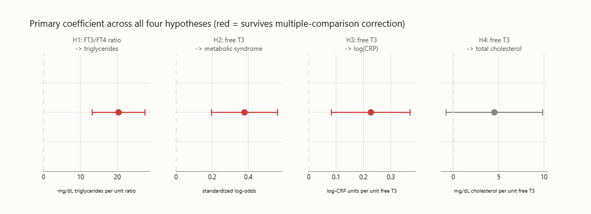
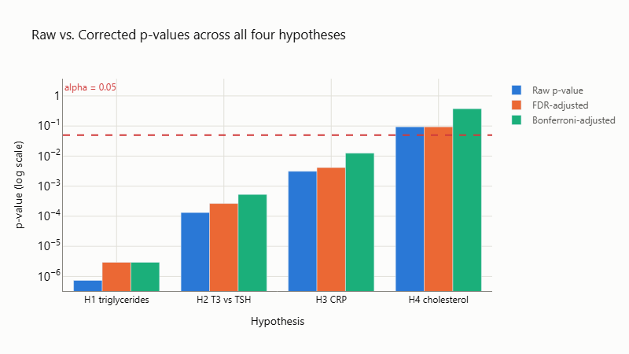

In this project, I tested some claims derived from the thinkings and opinions of Ray Peat, 
a prominent researcher with a Ph.D. in biology from the University of Oregon, and some opinions 
from the Peat-sphere on X/Twitter. Peat's central claim is that energy and structure 
are interdependent at every level.

In the past few years, Ray Peat's ideologies have been pushed prominently on social media,
becoming the topic of many widespread conversations from health and gym-bros alike. His takes
on dieting have become widespread and the center of many debates.

Using NHANES data, I decided to take a look and see if some of the claims made online and by Peat himself hold up or fall short. 
One of Peat's central claims is that PUFA (polyunsaturated fatty acids), now common in the modern food supply through seed oils, 
suppresses thyroid conversion and drives inflammation. If most people's diets do skew toward high PUFA intake the way Peat's framework assumes, 
that raises a grand question. Either the thyroid axis behaves the way the framework predicts and the diet claim matters, or it doesn't and the diet claim is irrelevant, 
regardless of how common seed oils are. It is important to note that this analysis does not measure anyone's diet directly. 
NHANES has dietary recall data, but that's not what is being used here. Instead, I'm testing the claims at the level Peat's framework actually depends on. 
That means looking at circulating hormone levels and the metabolic markers they're supposed to predict.

**The short version is that the hypotheses tested didn't hold up.** Three of four pre-registered
hypotheses were falsified, and all three statistically significant results
ran in the opposite direction from what the framework predicts.

## The question

Peat's framework argues that efficient thyroid hormone conversion (T4 → T3)
and adequate free T3 drive a more efficient, "pro-metabolic" physiology,
protecting against high triglycerides, inflammation, and other markers of
metabolic dysfunction. I turned that into four pre-registered hypotheses and
tested each one against [NHANES](https://www.cdc.gov/nchs/nhanes/) data
(2007–2012, the three cycles with a full thyroid panel), using
non-pregnant adults age 20+ with no thyroid disease or thyroid medication use.
Sample sizes range from 3,371 to 6,283 depending on the hypothesis, since some
outcomes need a fasting blood draw and CRP was only measured through 2010.

## The methodology

Some choices in the analysis that I made:

- **Design-based survey weights, strata, and PSUs** -- NHANES is not a simple
  random sample, so unweighted statistics would misrepresent the U.S.
  population.
- **Pooling across three survey cycles** using the standard NHANES
  divide-by-number-of-cycles weighting approach, to get enough sample size
  for the less common outcomes (e.g. metabolic syndrome).
- Adjusting the weights for the thyroid subsample. Starting in 2009, NHANES
  only ran the thyroid panel on a random third of participants, so each
  cycle's weight has to account for that. Without it, the 2007–2008 cycle ends
  up carrying way more than its share of the pooled weight.
- Excluding one implausible record. One participant had a free T3 of
  28.84 pg/mL, about seven times the upper reference limit, while their total
  T3 was normal. Both values can't be right, so I dropped it as a lab or
  recording error.
- **FDR and Bonferroni correction across all four hypotheses' primary
  tests** — evaluating four hypotheses at p \< 0.05 without correction
  overstates the evidence.

## What I found

| # | Hypothesis | Result |
|---|---|---|
| H1 | Higher FT3/FT4 ratio -> lower triglycerides | **Falsified** — significant, opposite direction, survives correction |
| H2 | Free T3 outperforms TSH at predicting metabolic syndrome | **Supported as worded**, but higher free T3 goes with higher odds of metabolic syndrome |
| H3 | Lower free T3 -> higher CRP (inflammation) | **Falsified**, significant in the opposite direction and survives correction |
| H4 | Higher free T3 -> lower total cholesterol | **Falsified**, no significant association in the primary model |

Three of the four primary tests survived the correction, and all three of them
went against the framework.

- A higher free-T3/free-T4 ratio is associated with **higher** triglycerides
  (+20.3 mg/dL per unit ratio, p \< 0.001). Adjusting for BMI barely changes
  it (+19.7 mg/dL), and swapping in total T3 and T4 for the free hormones
  gives the same direction.
- Higher free T3 is associated with **higher** CRP. Each extra 1 pg/mL of free
  T3 lines up with roughly 25% more CRP (p = 0.003, and p = 0.012 after
  Bonferroni).
- Higher free T3 is also associated with **higher** odds of metabolic syndrome
  (p \< 0.001). Free T3 did beat TSH as a predictor, with an AUC of 0.829
  compared to 0.824, but that gap is small and I didn't formally test it.
  Neither one adds much over age, sex, and BMI on their own (AUC 0.823).

H4 came back null. Free T3 had a positive association with total cholesterol,
but it wasn't significant (+4.5 mg/dL per pg/mL, p = 0.094). If the one
implausible record is kept in, H2 and H3 lose significance, but none of the
verdicts change.

## My thoughts

During this process, I was treating Peat's and the Peat-sphere's claims as something that is testable.
Using the NHANES sample, none of the hypotheses I tested held up the way the framework predicts.

Three results survived the multiple-comparison correction, and all of them reversed from my original hypotheses. The first is that
a higher free-T3/free-T4 ratio is associated with higher triglycerides, not lower. After adjusting the original sample for BMI, the results 
did not have a significant change. The second is that higher free T3 is associated with higher CRP, so more inflammation instead of less.

In other hypotheses, free T3 did not predict lower total cholesterol. As for free T3 versus TSH as a predictor of metabolic syndrome, 
free T3 technically won. It had a slight edge in overall predictive power on AUC and AIC, and its individual coefficient reached significance
while TSH's did not. The catch is that higher free T3 was associated with higher odds of metabolic syndrome. So free T3 is the better
predictor, but it points the wrong way for the framework, which makes it the third result that reversed.

However, as noted at the beginning of this piece, the suggesting framework to take away from this is that
circulating free T3 and the FT3/FT4 ratio are bad indicators for the Peat framework described as "pro-metabolic."

According to the Peat community on forums and social media like X/Twitter, many advocates would point towards the fact that labs are targetting the wrong things.
They would say that free T3, free T4, and TSH are weak tests for the pro-metabolic framework, arguing that factors like temperature, pulse, cholesterol,
and prolactin are better markers. However, it is important to note that this is a potential issue with the markers, not the actual regressions. The NHANES data does 
not contain things like temperature and prolactin, but pulse and cholesterol are used, which is why I used them in the additional hypothesis.

So while the original hypotheses were against the Peat framework, that is not to say that the cause of these things are shown. 
Things like obesity and a fatty liver can change the overall conversion and cause worsening lipids in the body. Illness suppressing T3 is another
common explanation, but that would make low T3 line up with high CRP, which is the opposite of what showed up here.
In this analysis I did not disprove bioenergetics, but none of the hypotheses that I tested held up using national data.

In my opinion, I think that the conclusion that you should draw from this is that single free-T3 or the FT3/FT4 ratio values cannot be used as evidence
regarding someone's metabolism and being "protected." An interesting question that now resides, is whether these functional markers, or a change after thyroid medication or diet intervention,
can be differentiated and behave differently. Unfortunately, NHANES can only provide so much data.

## Full analysis

The complete pipeline, notebooks, and writeup are on GitHub at
[Project Bioenergetics](https://github.com/dayconnor/nhanes-bioenergetics).
That includes the full results for the exploratory pulse and cholesterol
analysis (H5), which isn't covered here.

## Revision note

I updated this analysis in November 2026. The first version didn't account for
NHANES running the thyroid panel on a one-third subsample from 2009 onward,
kept the implausible free T3 record, and only checked the first drug category
slot when flagging medication use. Fixing those three things changed two of
the verdicts. H3 went from not significant after correction to significant in
the opposite direction. H2 went from ambiguous to free T3 winning, even though
free T3 points the wrong way. The H1 coefficient also went up from +14.9 to
+20.3 mg/dL. The full details are in the repo's
[revision note](https://github.com/dayconnor/nhanes-bioenergetics#revision-note).
